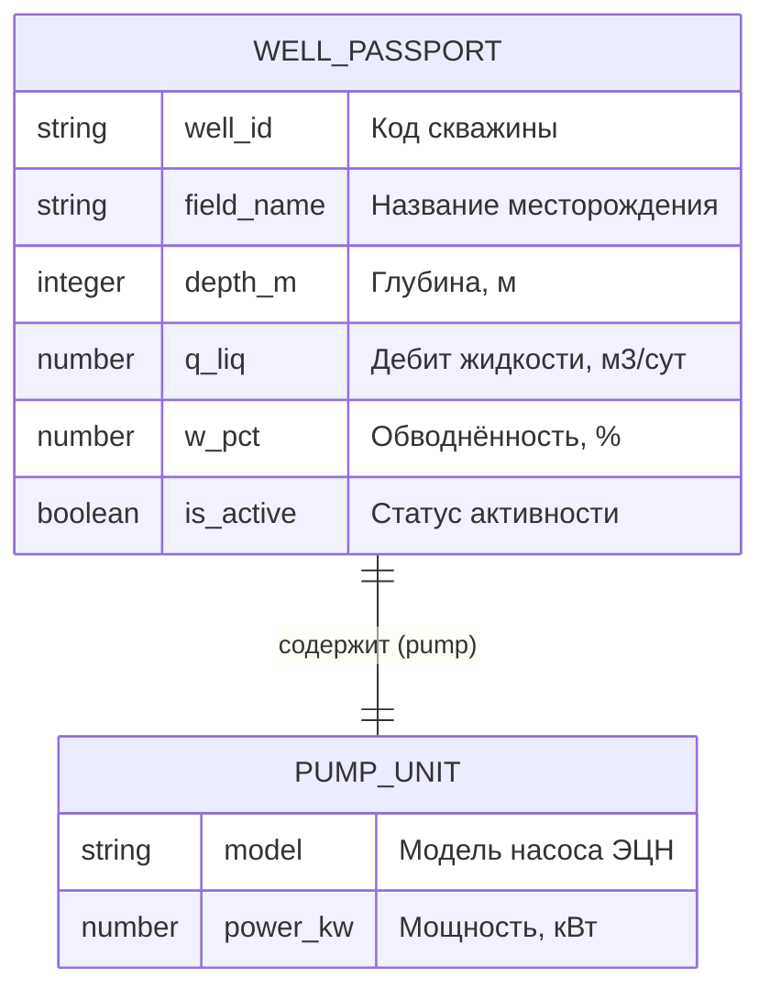

# Практическая работа № 2 - базовый уровень, вариант А
## Цифровой паспорт нефтяной скважины и погружного насоса

**Участники:** Денис Низамов - № 2; Алексей Каримов - № 3.  
**Расчёт варианта:** N = 2 + 3 = 5.  
**Этап 1:** Денис Низамов - системный аналитик; Алексей Каримов - разработчик.  
**Этап 2 (смена ролей):** Алексей Каромов - системный аналитик; Денис Низамов - разработчик.

## Индивидуальные параметры
| Параметр | Формула | Значение |
|---|---|---:|
| well_id | W-(100 + N) | W-105 |
| depth_m | 1500 + 50 × (N mod 40) | 1750 м |
| q_liq | 45.0 + 3.5 × (N mod 30) | 62.5 м³/сут |
| w_pct | 12.0 + 2.0 × (N mod 35) | 22.0 % |
| power_kw | 40.0 + 5.0 × (N mod 20) | 65.0 кВт |

## Data Dictionary
| Поле | Описание | Тип Python / JSON | Обязательное | Значение |
|---|---|---|---|---|
| well_id | Код скважины | str / string | Да | W-105 |
| field_name | Название месторождения (челлендж № 1) | str / string | Да | Приобское |
| depth_m | Глубина, м | int / integer | Да | 1750 |
| q_liq | Дебит жидкости, м³/сут | float / number | Да | 62.5 |
| w_pct | Обводнённость, % | float / number | Да | 22.0 |
| is_active | Статус работы | bool / boolean | Да | true |
| pump | Вложенный объект насоса | dict / object | Да | см. ниже |
| pump.model | Модель насоса | str / string | Да | ЭЦН5-80-1800 |
| pump.power_kw | Мощность насоса, кВт | float / number | Да | 65.0 |

## ER-диаграмма


## Файлы проекта и запуск
- `entity_model.py` формирует паспорт, сохраняет его в `data.json`, читает обратно и считает дебит чистой нефти.
- `schema.json` задаёт JSON-контракт, включая поле `field_name`.
- `validator.py` проверяет эталонные и ошибочные данные.
- `data.json` - готовый JSON-паспорт.

Запуск из этой папки:
```bash
python entity_model.py
python validator.py
```

## Результаты проверки валидатора
| Сценарий | Ожидаемый результат | Фактический результат |
|---|---|---|
| 1. Эталонный `data.json` | VALID | VALID, ошибок нет |
| 2. Глубина −100 и обводнённость 145% | Отклонено, 2 нарушения диапазона | Отклонено: нарушены границы `depth_m` и `w_pct` |
| 3. Удалено `well_id` | Отклонено, обязательное поле | Отклонено: отсутствует `well_id` |
| 4. Текст вместо `pump.power_kw` | Отклонено, неверный тип | Отклонено: `pump.power_kw` должно быть числом |
| 5. В `broken_data.json` скрыты 2 нарушения | Отклонено, обе причины найдены | Отклонено: отсутствует `field_name`; неверный тип `pump.power_kw` |

## Контрольные вопросы
**1.1. Почему удобнее передавать единый словарь?**  
Словарь объединяет связанные атрибуты одного объекта, позволяет обращаться к данным по именованным ключам и проще расширяется. Это уменьшает риск перепутать порядок множества аргументов и упрощает передачу/сохранение всей карточки.

**1.2. Чем JSON отличается от Python dict? Зачем `ensure_ascii=False`?**  
В JSON ключи и строки обязательно заключаются в двойные кавычки; логические значения записываются как `true`/`false`, а отсутствие значения - `null`; JSON является текстовым форматом обмена, а dict - объектом Python. `ensure_ascii=False` сохраняет кириллицу читаемой, а не заменяет её escape-последовательностями `\u....`.

**2.1. Что такое JSON-Schema?**  
Это формальное описание структуры и ограничений данных. `required` задаёт обязательные поля, `properties` - свойства и их типы, `minimum`/`maximum` - числовые границы, `enum` - допустимые значения из ограниченного списка.

**2.2. Зачем проверять `not isinstance(depth, bool)`?**  
В Python `bool` является подклассом `int`, поэтому `isinstance(True, int)` возвращает `True`. Дополнительная проверка не позволяет принять логическое значение за целочисленную глубину.

## Наблюдение по JSON
В `data.json` ключи и текстовые значения заключены в двойные кавычки, а `True` из Python записано как `true`. Кириллица сохранена благодаря `ensure_ascii=False`.
